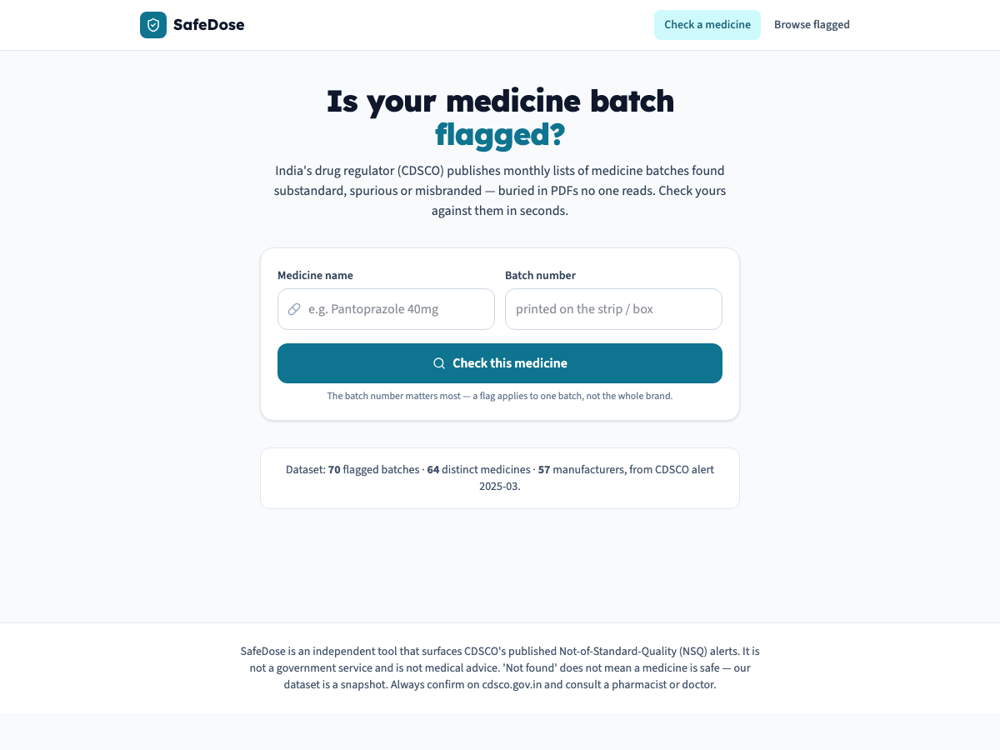
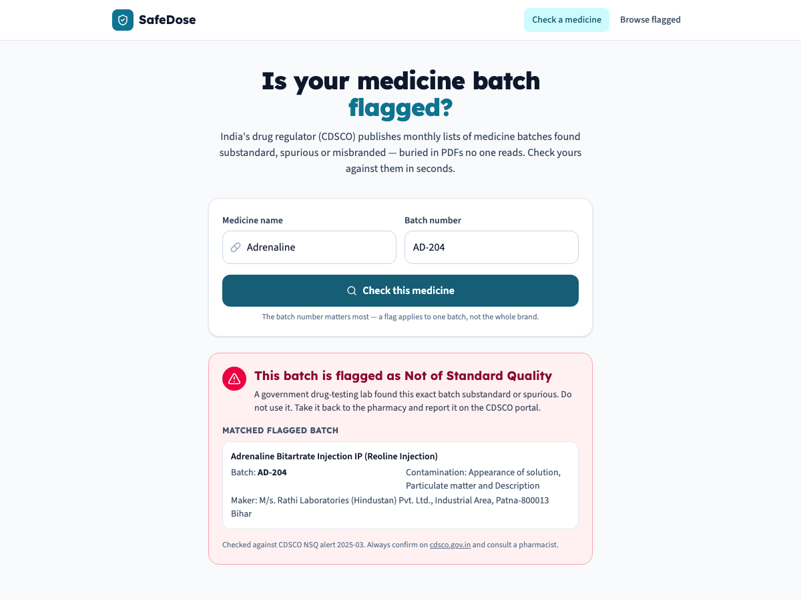
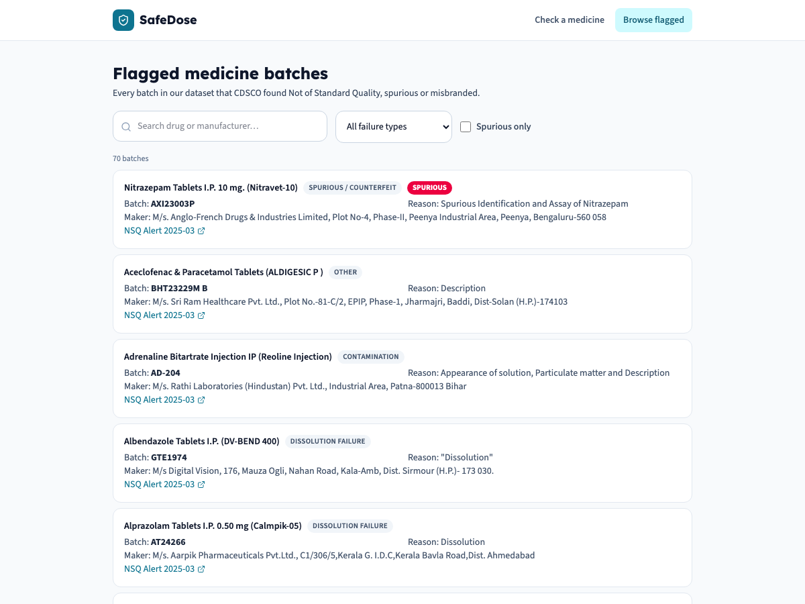

# SafeDose

**Check whether your medicine's batch has been flagged as substandard or spurious by India's drug regulator — in seconds, from data that's otherwise buried in PDFs.**

Every month, the Central Drugs Standard Control Organisation (CDSCO) tests samples of medicines sold in India and publishes a **"Not of Standard Quality" (NSQ) alert** — a list of specific drug *batches* found substandard, contaminated, mislabelled, or outright **spurious (counterfeit)**. In a single recent month, 70 batches were flagged, from antibiotics to anaesthetics.

That information is life-critical and completely public — and almost no one can use it, because it ships as **unindexed PDF tables on a government portal**. No patient is going to read a 9-page PDF to check the strip in their hand. SafeDose turns those PDFs into a question anyone can ask: *"Is this batch on the list?"*

| | | |
|---|---|---|
|  |  |  |

## How it works

### The data — real CDSCO alerts, parsed from source

The dataset is built by an ETL pipeline that reads the **actual CDSCO NSQ alert PDFs** and extracts every row:

```
S.No | Product/Drug Name | Batch No. | Mfg Date | Expiry | Manufactured By | NSQ Result | Tested By
```

[`backend/app/parser.py`](backend/app/parser.py) handles the real-world mess: it locates the header row (which repeats on every page), maps columns by fuzzy name (CDSCO's headers drift between months), pulls only true data rows, and classifies each free-text failure reason ("Dissolution (Buffer Stage)", "Particulate Matter", "Declared Spurious") into a coarse category. The raw source PDF is committed under [`backend/data/raw/`](backend/data/raw/) so the pipeline is fully reproducible:

```bash
python -m app.parser data/raw/NSQ_Alert_March-2025.pdf \
    --period 2025-03 --source-url "https://cdsco.gov.in/.../March-2025.pdf" \
    --out data/nsq_records.json
```

The shipped dataset is CDSCO's **March 2025 alert (70 real flagged batches, 64 distinct medicines)**. Adding a month is one command — drop in the PDF, run the parser, re-seed.

### The matching engine — built to never over-reassure

A flag applies to a **batch**, not a brand, so batch number is the identity. [`backend/app/engine.py`](backend/app/engine.py) returns one of three states, and the design is deliberately conservative because the dangerous failure mode in a drug-safety tool is *false reassurance*:

| Result | When | Severity |
|---|---|---|
| **Batch flagged** | the exact (normalized) batch is on an NSQ list | 🔴 danger |
| **Caution** | a flagged batch shares the number but a *different* drug name (batch numbers aren't globally unique), **or** other batches of the same medicine are flagged | 🟠 caution |
| **Not found** | nothing matched — *explicitly not a safety guarantee* | 🟢 clear-but-hedged |

Two details that matter:
- **Batch normalization** — `AD-204`, `ad 204` and `AD204` all compare equal (punctuation and case are stripped), because the number on the strip rarely matches the PDF's formatting exactly.
- **Collision honesty** — a short batch like `0081` can appear under unrelated drugs. An exact batch hit is only called a confident danger when the *drug name* is also similar (token-overlap + sequence similarity on the molecule, ignoring dosage-form noise and bracketed brand names). Otherwise it's surfaced as a caution with the matched record shown — never hidden, never overclaimed.

**Example.** A patient holds an *Adrenaline* injection, batch `AD-204`:

```
query: drug="Adrenaline", batch="AD-204"
→ normalized batch AD204 matches a flagged record
→ drug name "Adrenaline" is similar to "Adrenaline Bitartrate Injection IP (Reoline)"
→ BATCH FLAGGED · danger
  "A government lab found this exact batch substandard. Do not use it."
  Maker: M/s. Rathi Laboratories (Hindustan) Pvt. Ltd., Patna — Reason: Appearance / particulate matter
```

### API

```
GET /api/check?drug=&batch=   three-state result with the matched records and reasons
GET /api/alerts?q=&category=&spurious=   browse/filter all flagged batches
GET /api/stats                dataset summary
GET /api/meta                 disclaimer
GET /api/health
```

Consistent `{"error": {code, message}}` envelope; nothing about the query is stored.

## Running it

```bash
docker compose up --build
# frontend → http://localhost:3100   API → http://localhost:8100/docs
```

Local development:

```bash
cd backend
python3 -m venv .venv && .venv/bin/pip install -r requirements-dev.txt
DATABASE_URL=sqlite:///dev.db .venv/bin/python -m scripts.seed
DATABASE_URL=sqlite:///dev.db .venv/bin/uvicorn app.main:app --reload --port 8100
# in another shell
cd frontend && npm install && npm run dev
```

### Tests

```bash
cd backend && .venv/bin/python -m pytest    # 32 tests
```

The suite runs the **real March 2025 PDF** through the parser (asserting known real entries are extracted), pins every engine state including the batch-collision and "not-found-is-not-safe" cases, and exercises the API against the real dataset.

## Data sourcing & verification

- Data comes **only** from official CDSCO NSQ alert PDFs; the source URL and alert period travel with every record, and the raw PDF is committed for audit.
- Failure reasons are kept **verbatim** from CDSCO; the category is a derived convenience, never a substitute for the original text.
- The UI repeats on every surface: *confirm on cdsco.gov.in, and "not found" is not a guarantee of safety.*

## Limitations

- **It's a snapshot.** The shipped dataset is one month's alert. CDSCO publishes monthly; a production deployment would run the ingester on a schedule.
- **CDSCO only catches what it samples.** Absence from the list means "not caught," not "safe" — the tool says so, loudly.
- **Name matching is heuristic.** Indian brand names map to molecules in messy ways; the engine errs toward showing more (caution) rather than hiding a possible match.

## What I'd build next

1. **Automated monthly ingestion** — a scheduled job that pulls each new CDSCO alert, diffs it, and notifies subscribers if a medicine they take is flagged.
2. **State drug-alert coverage** — state FDAs publish their own NSQ lists; fold them in for far wider coverage.
3. **Barcode / 2D-code scanning** — newer strips carry GS1 codes with batch + manufacturer; scan instead of type.
4. **Manufacturer risk view** — repeat-offender manufacturers across months, to surface systemic bad actors.
